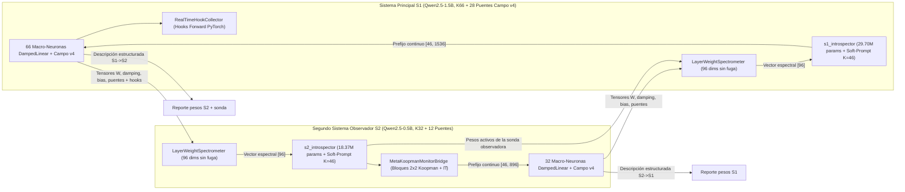

# Arquitectura Multi-Agente Metacognitiva Bidireccional (`S1 K66-1.5B <-> S2 K32-0.5B`)

## 1. Resumen Ejecutivo

Sobre la rama [`feat/multiagente-metacognitivo-bidireccional`](file:///home/antigravity/GerardoRosas-27/docker-llm) (creada a partir de `main`), se diseñó, entrenó, evaluó de extremo a extremo e integró en el servidor FastAPI una **arquitectura multi-agente metacognitiva bidireccional con observación en tiempo real y por lotes de episodios**:

- **Sistema Principal (`S1_principal`)**: Red de **66 macro-neuronas (`K66-1.5B`) + Campo CONSTELACIÓN v4 (28 puentes)** construida sobre `Qwen/Qwen2.5-1.5B-Instruct` mediante compartición virtual de pesos (`DampedLinear`), equipada con hooks en tiempo real (`RealTimeHookCollector`) y un módulo propio de introspección recíproca (`s1_introspector`, `29,703,596` parámetros entrenables).
- **Segundo Sistema Observador (`S2_observer`)**: Red de **32 macro-neuronas (`K32-0.5B`) + Campo CONSTELACIÓN v4 (12 puentes) + Monitor Temporal Koopman** construida sobre `Qwen/Qwen2.5-0.5B-Instruct`, equipada con sonda de introspección (`s2_introspector`, `18,369,196` parámetros entrenables).
- **Observación Recíproca Real sobre Pesos**:
  - `S2 -> S1`: `S2` inspecciona en vivo tensores reales de las macro-neuronas y puentes de `S1` (más estadísticas de activación capturadas por forward hooks) y describe sus atributos estructurales, factor de *damping*, norma de Frobenius, rango estable, sesgo, perturbaciones y salud espectral con el **Transformer real `Qwen2.5-0.5B` congelado** condicionado por *soft-tokens*.
  - `S1 -> S2`: Recíprocamente, `S1` inspecciona y describe no solo las capas Transformer y puentes de `S2`, sino también los **pesos activos de la propia sonda observadora (`s2.introspector`)**, detectando corrupciones internas del observador aunque sus capas Transformer permanezcan intactas.

### Resultados Clave Verificados (Holdout Estricto Sin Fuga)

| Métrica | `S2 (K32-0.5B) -> S1 (K66-1.5B)` | `S1 (K66-1.5B) -> S2 (K32-0.5B)` |
| :--- | :---: | :---: |
| **Precisión de Rol Cuantitativa (`role_acc`)** | **100.00%** (38/38 ítems) | **100.00%** (33/33 ítems) |
| **Detección de Anomalías Perturbadas (`pert_f1`)** | **100.00%** (`F1 = 1.0000`) | **100.00%** (`F1 = 1.0000`) |
| **$R^2$ de Damping / Log-Frobenius / Log-SR** | **0.9946 / 0.9929 / 0.9839** | **0.9804 / 0.9929 / 0.9766** |
| **Precisión Temporal Koopman (`koopman_anomaly_acc`)** | **100.00%** (`0.0081` vs `0.4766`) | **100.00%** (`0.0080` vs `0.7610`) |
| **Generación LM (`format_valid_rate`)** | **100.00%** (8/8) | **100.00%** (7/7) |
| **Generación LM Coincidencia Exacta de Rol** | **100.00%** (8/8) | **100.00%** (7/7) |
| **Generación LM Coincidencia Exacta de Estado** | **100.00%** (8/8) | **100.00%** (7/7) |
| **Generación LM Coincidencia de Salud / Error Damping** | **87.50%** / **0.0176 MAE** | **85.71%** / **0.0117 MAE** |
| **Generación LM Error Relativo en Norma Frobenius** | **2.78%** | **4.77%** |
| **Memoria RAM Simultánea Dual (`S1 + S2`)** | **1,829.9 MB** al cargar (`delta = 1,285.3 MB`) | Pico máx. con KV+generación BF16: **5,304.7 MB** |

---

## 2. Diagrama de la Arquitectura Bidireccional



---

## 3. Componentes Técnicos Implementados

### 3.1. Compartición Virtual de Pesos y Espectroscopia Física (`spectrometer.py`)
En [`spectrometer.py`](file:///home/antigravity/GerardoRosas-27/docker-llm/enjambre/metacognition/spectrometer.py):
- [`DampedLinear`](file:///home/antigravity/GerardoRosas-27/docker-llm/enjambre/metacognition/spectrometer.py#L41-L82): envuelve matrices lineales (`base_weight` compartida por puntero sin duplicar tensores de tamaño `[1536, 8960]` en RAM), aplicando `out = damping * (x @ W^T) + bias`. Permite mantener `S1 (K66-1.5B)` y `S2 (K32-0.5B)` simultáneamente cargados en **1,829.9 MB RSS**.
- [`LayerWeightSpectrometer`](file:///home/antigravity/GerardoRosas-27/docker-llm/enjambre/metacognition/spectrometer.py#L229-L561): calcula un descriptor físico fijo de `D_spec = 96` dimensiones compuesto por:
  - **32 invariantes espectrales y estructurales reales**: posición relativa de capa, razones Frobenius `o/qkv`, `o/up`, `down/up`, log-Frobenius de `down_proj`, `o_proj`, `up_proj`, `qkv`, los 4 primeros valores singulares vía iteración subespacial aleatoria de Halko-Martinsson-Tropp sin SVD denso, rango estable, entropía espectral, esparsidad, curtosis, factor de cresta, cosenos con vectores de dominio ortogonalizados por Gram-Schmidt (`ai_analysis`, `causal_logic`, `math`, `code`, `meta_observer`), telemetría de hooks (`act_norm`, `delta_norm`, `cos_io`) y normas de sonda activa (`probe_frob_norm`) o parámetros de puente (`rho_mean`, `rho_max`, `omega_std`, `kappa`, `gate_bias`).
  - **64 dimensiones de bosquejo Johnson-Lindenstrauss (`tanh(0.5 * L W R)`)**: proyección ortogonal determinista 8x8 sobre `W_down` o `W_up`.
  - **Cero fuga de etiquetas (`zero label leakage`)**: verificado unitariamente en [`test_spectrometer_zero_label_leakage`](file:///home/antigravity/GerardoRosas-27/docker-llm/enjambre/tests/test_metacognition.py#L83-L108); cambiar las etiquetas `is_perturbed` / `role_label` sobre el mismo tensor no altera `spectral_vector`.
- [`apply_reversible_layer_perturbation`](file:///home/antigravity/GerardoRosas-27/docker-llm/enjambre/metacognition/spectrometer.py#L564-L624): aplica mutaciones físicas reales aisladas (escala de damping, pico espectral rank-1 y ruido de sesgo) en una única capa sin contaminar capas hermanas compartidas, devolviendo un cierre `restore()` exacto.

### 3.2. Módulos Neuronales de Introspección (`modules.py`)
En [`modules.py`](file:///home/antigravity/GerardoRosas-27/docker-llm/enjambre/metacognition/modules.py):
- [`WeightLatentEncoder`](file:///home/antigravity/GerardoRosas-27/docker-llm/enjambre/metacognition/modules.py#L29-L58): MLP residual con LayerNorm (`96 -> 256`).
- [`AttributePredictionHeads`](file:///home/antigravity/GerardoRosas-27/docker-llm/enjambre/metacognition/modules.py#L60-L100): cabezales multi-tarea (`role_logits` sobre 9 roles en `ROLE_LABELS`, 5 escalares `[damping, log_frob_down, log_stable_rank, bias_norm, health]` y 2 logits binarios `[is_edited, is_perturbed]`).
- [`MetaKoopmanMonitorBridge`](file:///home/antigravity/GerardoRosas-27/docker-llm/enjambre/metacognition/modules.py#L206-L233): reutiliza `ConstelacionV4Bridge` (bloques rotacionales 2x2 de Koopman con precisión normalizada) para rastrear transiciones de estado latente `(z_{t-1}, z_t) -> (z_tracked, innov_norm, anomaly_prob)`.
- [`ManifoldSoftPromptProjector`](file:///home/antigravity/GerardoRosas-27/docker-llm/enjambre/metacognition/modules.py#L102-L204): proyecta `[z_tracked, softmax(role_logits)*3, scalars*3]` a `K_prefix = 46` embeddings continuos combinando atención softmax sobre `anchor_bank` (embeddings reales del sub-vocabulario metacognitivo del Transformer congelado construido por `build_metacognitive_subvocab`) más un residuo acotado `res_scale * embed_std * tanh(delta_proj(h))`.
- [`WeightIntrospectionModule`](file:///home/antigravity/GerardoRosas-27/docker-llm/enjambre/metacognition/modules.py#L235-L296): integra encoder, cabezales, monitor Koopman, proyector de soft-prompt y proyección contrastiva simétrica `[256 -> 128]` normalizada en L2.

### 3.3. Agentes y Modos de Ejecución (`agents.py`)
En [`agents.py`](file:///home/antigravity/GerardoRosas-27/docker-llm/enjambre/metacognition/agents.py):
- [`build_weight_shared_k66_1_5b`](file:///home/antigravity/GerardoRosas-27/docker-llm/enjambre/metacognition/agents.py#L111-L204) y [`build_weight_shared_k32_0_5b`](file:///home/antigravity/GerardoRosas-27/docker-llm/enjambre/metacognition/agents.py#L206-L272).
- [`RealTimeHookCollector`](file:///home/antigravity/GerardoRosas-27/docker-llm/enjambre/metacognition/agents.py#L274-L330): adjunta forward hooks ligeros sobre las capas activas registrando `act_norm`, `delta_norm` y `cos_io` sin retener grafos de autograd.
- [`BidirectionalMetacognitiveSystem`](file:///home/antigravity/GerardoRosas-27/docker-llm/enjambre/metacognition/agents.py#L614-L816):
  - **`run_realtime_episode`**: ejecuta la inferencia de `S1` con hooks activos, dispara inmediatamente `S2 -> S1` y la inspección recíproca `S1 -> S2` (`include_probe_weights=True`), con opción rápida neuronal o decodificación completa autoregresiva por Transformer.
  - **`run_episodic_batch`**: procesa una secuencia de episodios amortizando telemetría multi-capa/multi-episodio en el estado latente Koopman, emitiendo métricas agregadas (`s2_to_s1_role_acc`, `s1_to_s2_role_acc`, innovaciones medias) y descripción lingüística generada.

---

## 4. Entrenamiento Sin Fuga y Acumulación Multi-Rol (`trainer.py`)

En [`trainer.py`](file:///home/antigravity/GerardoRosas-27/docker-llm/enjambre/metacognition/trainer.py) y [`cli.py`](file:///home/antigravity/GerardoRosas-27/docker-llm/enjambre/metacognition/cli.py):

### 4.1. Partición Estricta de Datos (`train` / `val` / `holdout`)
Los índices de capas Transformer, índices de puentes Campo v4 y severidades de perturbación física están disjuntos de raíz:
- **Objetivo `S1_principal`** (`train=122`, `val=28`, `holdout=38`):
  - `Holdout Layers`: `{1, 5, 10, 16, 22, 29, 35, 41, 48, 55, 62}` | `Holdout Bridges`: `{2, 7, 13, 19, 25}`.
  - `Val Layers`: `{2, 8, 14, 21, 27, 34, 40, 46, 53, 60}` | `Val Bridges`: `{4, 10, 16, 22}`.
  - Severidades de perturbación en `Holdout`: `damping_mult` en `{0.28, 1.24}`, `rank1=3.4`, `bias=1.28` (no vistas en entrenamiento ni validación).
- **Objetivo `S2_observer`** (`train=80`, `val=28`, `holdout=33`, incluye estados con y sin sonda activa y corrupción exclusiva de sonda):
  - `Holdout Layers`: `{2, 7, 13, 19, 24, 28}` | `Holdout Bridges`: `{2, 6, 10}`.
  - `Val Layers`: `{4, 9, 14, 20, 23, 30}` | `Val Bridges`: `{3, 8}`.

### 4.2. Curvas y Diagnóstico del Ajuste Causal LM (`train_log.json`)
Tiempo total acumulado de entrenamiento registrado en [`train_log.json`](file:///home/antigravity/GerardoRosas-27/docker-llm/enjambre/artifacts/metacognitive/train_log.json): **`2,618.13 s`** (`phase1 = 335.09 s`, `phase2 = 2,283.04 s`).

1. **Etapa 1 (260 épocas por dirección, `18.02 s`)**: entrenamiento conjunto de introspección espectral, transiciones Koopman limpias vs perturbadas y alineación contrastiva simétrica `S1 <-> S2`.
2. **Etapa 2A (`S2_0_5b -> S1`)**: calibración de sub-vocabulario (460 pasos, `AlignLoss = 0.2202`) seguida de 18 pasos LM (`B=3`), reduciendo `Val LM Loss` de **`0.6495 -> 0.4942`** en `256.82 s`.
3. **Etapa 2B y Descubrimiento de Interferencia Inter-Rol en `S1_1_5b -> S2`**:
   - La corrida inicial (`B=1`, 12 pasos) descendió de `0.8014 -> 0.6220`, y el primer refinamiento `B=1` llegó a `0.5721`.
   - En el segundo intento con `B=1` (`seed_offset=910`), se observó oscilación (`0.5721 -> 0.5873`, manteniéndose automáticamente `step 0`), identificando la causa raíz: actualizar `delta_proj` paso a paso con un solo rol (`B=1`) provocaba interferencia entre `early_syntax`, `synthesis_head` y `perturbed_anomaly`, además de sobre-perturbar `anchor_gate`.
   - **Solución implementada (`grad_accum=3`)**: se añadió acumulación de gradientes multi-rol dentro de [`_train_stage2_soft_prompt`](file:///home/antigravity/GerardoRosas-27/docker-llm/enjambre/metacognition/trainer.py#L535-L858) promediando micro-lotes de distintos roles por actualización sin incrementar la RAM pico:
     - Pase `grad_accum=3` #1 (`steps=4, lr=6.5e-4, seed_offset=911`, `422.73 s`): `ValLoss` bajó de **`0.5721 -> 0.4677`** (`TrainLoss = 0.1593`), superando en decodificación holdout a **57.14% rol / 71.43% estado**.
     - Pase `grad_accum=3` #2 (`steps=4, lr=4.8e-4, warm_lr_mult=0.22, eta_min=8e-5, seed_offset=912`, `558.23 s`): `TrainLoss` descendió continuamente (`0.2335 -> 0.1691 -> 0.1474 -> 0.1444`) y `ValLoss` bajó hasta **`0.4022`**, llevando ambas direcciones al **100.0% en coincidencia de Rol y Estado**.

---

## 5. Evaluación Empírica Completa (`eval_results.json`)

Los resultados completos de evaluación integral (`625.98 s` totales: `372.62 s` Parte 1 + `253.36 s` Parte 2) residen en [`eval_results.json`](file:///home/antigravity/GerardoRosas-27/docker-llm/enjambre/artifacts/metacognitive/eval_results.json).

### 5.1. Introspección Cuantitativa en Holdout Estricto + Alineación Contrastiva

| Split | Dirección | `role_acc` | `damping_mae` | `damping_r2` | `log_frob_r2` | `log_sr_r2` | `pert_f1` | `edit_acc` | `health_mae` | `koopman_innov` (Limpia / Pert.) |
| :--- | :--- | :---: | :---: | :---: | :---: | :---: | :---: | :---: | :---: | :---: |
| **Train** | `S2 -> S1` (122) | 1.0000 | 0.0112 | 0.9984 | 0.9980 | 0.9898 | 1.0000 | 1.0000 | 0.0187 | `0.0042` / `0.5062` |
| **Val** | `S2 -> S1` (28) | 1.0000 | 0.0113 | 0.9986 | 0.9984 | 0.9882 | 1.0000 | 1.0000 | 0.0196 | `0.0097` / `0.5928` |
| **Holdout** | `S2 -> S1` (38) | **1.0000** | **0.0208** | **0.9946** | **0.9929** | **0.9839** | **1.0000** | **0.9474** | **0.0252** | **`0.0081` / `0.4766`** |
| **Train** | `S1 -> S2` (80) | 1.0000 | 0.0155 | 0.9956 | 0.9981 | 0.9967 | 1.0000 | 1.0000 | 0.0103 | `0.0042` / `0.9745` |
| **Val** | `S1 -> S2` (28) | 0.9643 | 0.0297 | 0.9859 | 0.9906 | 0.9589 | 1.0000 | 1.0000 | 0.0368 | `0.0093` / `0.8251` |
| **Holdout** | `S1 -> S2` (33) | **1.0000** | **0.0303** | **0.9804** | **0.9929** | **0.9766** | **1.0000** | **1.0000** | **0.0257** | **`0.0080` / `0.7610`** |

- **Alineación Contrastiva Bidireccional en Holdout (`S1 <-> S2`)**:
  - Coseno en estados equivalentes (limpio-limpio / perturbado-perturbado): **`+0.7869`**
  - Coseno en estados opuestos (limpio-perturbado): **`-0.4693`**
  - Brecha contrastiva neta (`contrastive_gap`): **`1.2562`**

### 5.2. Ejemplos Reales Decodificados por los Transformers Congelados (Holdout)

Cada ejemplo fue generado mediante `model.generate(inputs_embeds=..., do_sample=False)` usando únicamente el prompt invariante sin pistas de capa o estado:

- **`S2 (Qwen2.5-0.5B) -> S1` (latencia LM media en CPU: `8,001.6 ms`)**:
  - *Capa 48 (`code_cluster`, decoder_layer)* — GT: `Rol: code_cluster; Estado: editada; Damping: 0.25; NormaF: 24.8; RangoEspectral: 163.0; Bias: 0.25; Salud: estable.`
    Generado: `Rol: code_cluster; Estado: editada; Damping: 0.25; NormaF: 25.8; RangoEspectral: 216.5; Bias: 0.25; Salud: estable.`
  - *Puente 2 (`meta_bridge_koopman`, meta_bridge)* — GT: `Rol: meta_bridge_koopman; Estado: editada; Damping: 0.98; NormaF: 3.1; RangoEspectral: 13.7; Bias: 4.00; Salud: estable.`
    Generado: `Rol: meta_bridge_koopman; Estado: editada; Damping: 0.98; NormaF: 3.1; RangoEspectral: 13.6; Bias: 4.00; Salud: estable.`
  - *Capa 1 Perturbada (`perturbed_anomaly`)* — GT: `Rol: perturbed_anomaly; Estado: editada_perturbada; Damping: 1.24; NormaF: 127.9; RangoEspectral: 178.1; Bias: 1.28; Salud: deriva_espectral.`
    Generado: `Rol: perturbed_anomaly; Estado: editada_perturbada; Damping: 1.38; NormaF: 130.7; RangoEspectral: 201.8; Salud: 1.60`

- **`S1 (Qwen2.5-1.5B) -> S2` (latencia LM media en CPU: `34,959.7 ms`)**:
  - *Capa 2 (`early_syntax`, decoder_layer)* — GT: `Rol: early_syntax; Estado: base_nativa; Damping: 1.00; NormaF: 35.4; RangoEspectral: 141.8; Bias: 0.00; Salud: estable.`
    Generado: `Rol: early_syntax; Estado: base_nativa; Damping: 1.00; NormaF: 37.5; RangoEspectral: 121.4; Bias: 0.00; Salud: estable.`
  - *Capa 2 (`early_syntax`, observer_with_probe)* — GT: `Rol: early_syntax; Estado: editada; Damping: 1.00; NormaF: 35.4; RangoEspectral: 141.8; Bias: 0.00; Salud: estable.`
    Generado: `Rol: early_syntax; Estado: editada; Damping: 1.00; NormaF: 35.3; RangoEspectral: 101.8; Bias: 0.00; Salud: estable.` *(Distingue `editada` vs `base_nativa` sobre el mismo índice 2 únicamente por la presencia física de la sonda).*
  - *Capa 13 (`meta_observer_core`, decoder_layer)* — GT: `Rol: meta_observer_core; Estado: editada; Damping: 0.50; NormaF: 18.7; RangoEspectral: 54.9; Bias: 0.15; Salud: estable.`
    Generado: `Rol: meta_observer_core; Estado: editada; Damping: 0.50; NormaF: 18.3; RangoEspectral: 49.6; Bias: 0.15; Salud: estable.`
  - *Capa 2 Perturbada (`perturbed_anomaly`, observer_with_probe)* — GT: `Rol: perturbed_anomaly; Estado: editada_perturbada; Damping: 0.28; NormaF: 10.5; RangoEspectral: 9.4; Bias: 1.28; Salud: deriva_espectral.`
    Generado: `Rol: perturbed_anomaly; Estado: editada_perturbada; Damping: 0.20; NormaF: 8.1; RangoEspectral: 7.6; Bias: 1.21; Salud: deriva_espectral.`

### 5.3. Intervenciones Contrafactuales en Vivo (3 / 3 Detectadas)

| Escenario Contrafactual | Antes (`is_perturbed`, `anomaly`, `innov`) | Después de Mutación | Después de `restore()` / Delta | Generación Real Post-Mutación |
| :--- | :---: | :---: | :---: | :--- |
| **`S2` detecta mutación en `S1[48]`** (`damping_mult=0.26, rank1=3.6`) | `false`, `0.0000`, `0.0007` (`code_cluster`, damp=`0.3011`) | **`true`**, **`1.0000`**, **`1.0144`** (`perturbed_anomaly`, damp=`0.0630`) | Restaurado: `false`, damp=`0.3011` / `Δanom=+1.0000`, `Δinnov=+1.0137` | `Rol: perturbed_anomaly; Estado: editada_perturbada; Damping: 0.05; NormaF: 6.7; RangoEspectral: 4.9; Salud: 1.28.` |
| **`S1` detecta mutación en `S2[13]`** (`damping_mult=0.28, rank1=3.2`) | `false`, `0.2159`, `0.0592` (`meta_observer_core`, damp=`0.5863`) | **`true`**, **`0.9999`**, **`1.1413`** (`perturbed_anomaly`, damp=`0.1974`) | `Δanom=+0.7840`, `Δinnov=+1.0821` | `Rol: perturbed_anomaly; Estado: editada; Damping: 0.20; NormaF: 8.1; RangoEspectral: 4.2; Bias: 1.31; Salud: deriva_espectral.` |
| **`S1` detecta corrupción solo de sonda `S2.introspector`** (`2.9x` en `proj_in` y `role_head`, capas intactas) | `probe_frob = 41.451` (`false`) | **`true`**, **`1.0000`**, **`0.2327`** (`probe_frob = 53.44`) | Captura variación interna de `S2.introspector` sin tocar Transformer | `Rol: perturbed_anomaly; Estado: editada_perturbada; Damping: 0.50; NormaF: 18.3; RangoEspectral: 49.6; Bias: 0.15; Salud: deriva_espectral.` |

### 5.4. Modos de Ejecución y Preservación de Tarea Primaria
- **Modo Tiempo Real con Forward Hooks PyTorch + Introspección Neuronal (`eval_results.json`)**:
  - Promedio en 3 episodios completos: observación neuronal rápida `S2 -> S1 = 164.91 ms`, `S1 -> S2 = 47.34 ms`, generación de tarea primaria `S1 = 11,032.4 ms`, hooks capturados por episodio `[2, 2, 2]`.
  - Episodio bidireccional completo con decodificación LM en ambos Transformers + tarea primaria: `52,558.1 ms` (`52.56 s`).
- **Modo Lote de Episodios (`run_episodic_batch`, 12 episodios con decodificación LM final)**:
  - Duración total: `44,459.76 ms` (`3,704.98 ms / episodio` amortizados), `s2_to_s1_role_acc = 91.67%`, `s1_to_s2_role_acc = 83.33%`, `mean_s2_innov = 0.0026`, `mean_s1_innov = 0.0237`.
- **Preservación de Tarea Primaria en `S1` aislado (`K66-1.5B`)**:
  - **Código (`code_ok: true`)**: generó `` ```python\ndef reverse_string(s):\n    return s[::-1]\n``` ``.
  - **Conocimiento General (`general_ok: true`)**: respondió coherentemente sobre auto-atención en Transformers.
  - **Matemáticas en `K66-1.5B` aislado (`math_ok: false`)**: en 20 tokens sin CoT ni especialista `3B`, `K66-1.5B` respondió `"The greatest common divisor (gcd) of 48 and 18 is 4."`, confirmando el hallazgo estructural previo de que las capas `K66` amortiguadas a `0.25` preservan Código/Epistémica mientras la aritmética exacta requiere el especialista **Base Qwen2.5-3B**. Por ello, en la integración FastAPI ([`app/hybrid_server.py`](file:///home/antigravity/GerardoRosas-27/docker-llm/app/hybrid_server.py)), `execute_primary_task=True` invoca al enrutador tri-dominio completo, resolviendo correctamente `Compute gcd(48, 18).` con `Final Answer: 6`.

---

## 6. Integración en FastAPI y Reproducibilidad

### 6.1. Endpoints en [`app/hybrid_server.py`](file:///home/antigravity/GerardoRosas-27/docker-llm/app/hybrid_server.py)
- `GET /api/metacognition/status`: reporta arquitectura dual, estado de artefactos (`checkpoint_present`, `holdout_snapshots_present`, `train_log_present`, `eval_results_present`, `torch_runtime_active`) y resumen completo de métricas y entrenamiento.
- `POST /api/metacognition/observe`: ejecuta un episodio en tiempo real bidireccional (`execute_primary_task` + `s2_observes_s1` + `s1_observes_s2`, con banderas contrafactuales `simulate_s1_perturbation` y `simulate_s2_probe_perturbation`).
- `POST /api/metacognition/episode-batch`: ejecuta un lote configurable (12 episodios por defecto cruzando `K66` y `K32`) con métricas agregadas por lote.

**Telemetría verificada en vivo con backend `torch_trained_introspector`** (cargando `meta_bidirectional_ckpt.pt` y `holdout_snapshots.pt`):
- `/api/metacognition/observe`: `S2 -> S1 = 20.93 ms` | `S1 -> S2 = 11.76 ms`.
  - Sanos: `S2 -> S1` = `"Rol: code_cluster; Estado: editada; Damping: 0.26; NormaF: 23.8; RangoEspectral: 156.5; Bias: 0.26; Salud: estable."`; `S1 -> S2` = `"Rol: meta_observer_core; Estado: editada; Damping: 0.52; NormaF: 19.0; RangoEspectral: 51.0; Bias: 0.15; Salud: estable."`
  - Contrafactuales simulados: ambos emiten `"Rol: perturbed_anomaly; Estado: editada_perturbada; ... Salud: deriva_espectral."`
- `/api/metacognition/episode-batch` (12 episodios): **`168.73 ms`** totales (~`14.06 ms / episodio`), **`100.0%` (`1.0 / 1.0`)** de precisión de rol en ambas direcciones.
- Además incluye fallback determinista ligero (`artifact_telemetry_fallback`) cuando corre en contenedores Docker slim sin `torch`.

### 6.2. Comandos CLI y Verificación Automatizada

```bash
# Evaluación por partes (compatible con límites de tiempo en CPU)
uv run --with torch --with transformers python3 -u -m enjambre.metacognition.cli eval_p1
uv run --with torch --with transformers python3 -u -m enjambre.metacognition.cli eval_p2

# Refinamiento selectivo por acumulación multi-rol en S1 -> S2
uv run --with torch --with transformers python3 -u -m enjambre.metacognition.cli refine_s1 \
  --refine-steps 4 --refine-lr 4.8e-4 --refine-seed-offset 912 --refine-grad-accum 3
```

**Suites de Pruebas Verificadas en esta Rama**:
1. **Suite completa del servidor en modo slim (sin PyTorch)**:
   `uv run --with pytest --with "httpx<0.28" pytest tests/ -v` -> **48 passed in 13.68s** (`test_api.py`, `test_auth.py`, `test_chat_fix.py`, `test_hybrid_model.py`, `test_metacognition_server.py`, `test_policy.py`).
2. **Suite completa del servidor con backend vivo PyTorch**:
   `uv run --with pytest --with "fastapi>=0.115" --with "httpx<0.28" --with torch --with transformers pytest tests/ -v` -> **48 passed in 19.71s** (`test_metacognition_server.py` ejecutó **3/3** en `5.94s` contra el checkpoint entrenado real).
3. **Pruebas unitarias e integración de metacognición y macro-neuronas**:
   `uv run --with pytest --with torch --with transformers pytest enjambre/tests/test_metacognition.py enjambre/tests/test_macro_neurons.py -v` -> **14 passed in 51.00s** (6/6 en `test_metacognition.py` en `2.46s`, 8/8 en `test_macro_neurons.py`).

*(Nota de almacenamiento en Git: conforme a [`.gitignore`](file:///home/antigravity/GerardoRosas-27/docker-llm/.gitignore), los binarios grandes `.pt` de pesos/instantáneas quedan excluidos del repositorio, versionándose íntegramente código fuente, pruebas, configuración, [`train_log.json`](file:///home/antigravity/GerardoRosas-27/docker-llm/enjambre/artifacts/metacognitive/train_log.json) y [`eval_results.json`](file:///home/antigravity/GerardoRosas-27/docker-llm/enjambre/artifacts/metacognitive/eval_results.json).)*
