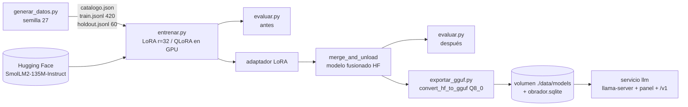

# Experimento: reentrenar un LLM chico con datos de una tienda de mochilas

Rama `exp/finetune-mochilas`. Objetivo: comprobar si es factible descargar el LLM más pequeño razonable,
reentrenar sus pesos con datos sintéticos de una empresa (modelos, precios, telas) y servirlo con el
panel existente (llama.cpp / GGUF).

## Arquitectura

| Pieza | Archivo | Notas |
| --- | --- | --- |
| Datos sintéticos | `finetune/generar_datos.py` | 30 mochilas (modelo, precio, tela, capacidad, color). Pares pregunta/respuesta en formato chat (`messages`). Semilla fija. |
| Holdout | mismo script | 60 preguntas (precio y tela de cada producto) con una redacción que **no** aparece en el entrenamiento. |
| Fine-tuning | `finetune/entrenar.py` | transformers + peft. LoRA en q/k/v/o/gate/up/down. `--qlora` carga en 4 bits (bitsandbytes, solo CUDA). Loss solo sobre la respuesta. Fusiona el adaptador y guarda el modelo completo. |
| Evaluación | `finetune/evaluar.py` | Generación greedy; acierto si el precio o la tela esperados aparecen en la respuesta. |
| Exportación | `finetune/exportar_gguf.py` | `convert_hf_to_gguf.py` de llama.cpp → Q8_0; con `--registrar` lo copia a `$DATA_DIR/models/` y lo marca `ready` en la SQLite del panel (aparece en Instalados). |
| Contenedor | `finetune/Dockerfile`, servicio `finetune` (perfil `train`) en `docker-compose.yml` | CPU por defecto; GPU cambiando la imagen base y descomentando `deploy.resources`. |

## Elección del modelo

**HuggingFaceTB/SmolLM2-135M-Instruct** (135 M parámetros, Apache 2.0, arquitectura Llama).

- Es el modelo instruct más pequeño con plantilla de chat que llama.cpp convierte sin trucos (arquitectura Llama).
- En fp32 cabe de sobra en CPU: se entrena en minutos, no horas, que es lo que se quería medir.
- Qwen2.5-0.5B-Instruct habla mejor español y sería el siguiente paso, pero son ~3.7× los parámetros (más tiempo y RAM). Para probar la *mecánica* (descargar → reentrenar → servir) el 135M basta.

## Resultados medidos

Máquina: Linux, 8 vCPU, 15 GB RAM, sin GPU, torch 2.11 CPU, transformers 4.57.6, peft 0.21.2.
Corrida del 3 nov 2026. Métricas completas: [`finetune-metricas.json`](finetune-metricas.json).

| Métrica | Valor |
| --- | --- |
| Parámetros base / entrenables (LoRA r=32) | 134 515 008 / 9 768 960 (7.3 %) |
| Ejemplos de entrenamiento / pasos | 420 / 424 (8 épocas, batch 8, lr 1e-3) |
| Tiempo de entrenamiento | 1 414 s (~23.6 min) |
| RAM pico del proceso (RSS) | 4 668 MB |
| Fusión del adaptador | 0.4 s |
| Adaptador / modelo fusionado (fp32) / GGUF Q8_0 | 38 MB / 518 MB / 145 MB |
| Conversión a GGUF | ~4.6 s |

Loss medio por época: 0.759 → 0.198 → 0.160 → 0.107 → 0.053 → 0.027 → 0.013 → **0.005**.

> Las épocas 1-5 tardaron ~80 s cada una. La 6 tardó ~750 s porque otro proceso pesado compartía la CPU en ese momento;
> sin esa carga el entrenamiento completo habría durado ~11 min.

Evaluación holdout (60 preguntas, generación greedy):

| | Precio | Tela | Total |
| --- | --- | --- | --- |
| Antes (modelo base) | 0 % | 0 % | 0 % |
| Después (fusionado) | 100 % | 100 % | 100 % |

Ejemplo, `Oye, ¿en cuánto me sale la mochila Nómada Urbana?`

- antes: «¡Hola! ¿Cómo estás trabajando con la mochila Nómada Urbana?»
- después: «La mochila Nómada Urbana cuesta $999 MXN.» (correcto)

El GGUF Q8_0 se cargó con llama.cpp (llama-cpp-python) y respondió igual de bien
(«La mochila Desierto Viaje está hecha de lona de algodón.», correcto) en ~0.1 s por respuesta.

## Conclusión de factibilidad

**Factible.** El ciclo completo (descargar → reentrenar pesos → fusionar → GGUF → servir con el panel) funciona en CPU,
con menos de 5 GB de RAM y en minutos, y el modelo pasa de 0 % a 100 % en precios y telas del catálogo.

Límites a tener presentes:

- El holdout cambia la **redacción** de la pregunta, pero los productos son los mismos que en el entrenamiento:
  mide memorización de hechos y robustez a paráfrasis, no generalización a productos nuevos.
- Un modelo de 135 M aprende bien respuestas cortas con formato fijo; con conversación libre, varios productos
  en una pregunta o catálogo que cambia seguido se degrada. Si los precios cambian a menudo, conviene RAG
  (inyectar el catálogo en el prompt) y dejar el fine-tuning para el tono y el formato.
- Datos sintéticos de plantilla: con datos reales habrá que limpiar y deduplicar, y vigilar el sobreajuste
  (loss 0.005 indica que el modelo memorizó).

## Escalar a GPU

1. `FT_BASE_IMAGE=pytorch/pytorch:2.5.1-cuda12.4-cudnn9-runtime FT_TORCH_INDEX=skip` y descomentar `deploy.resources` del servicio `finetune` (requiere NVIDIA Container Toolkit).
2. Para modelos ≥ 1.5 B: añadir `bitsandbytes` y `FT_TRAIN_ARGS=--qlora` (pesos base en 4 bits, LoRA en bf16).
3. Subir `FT_BASE_MODEL` (p. ej. `Qwen/Qwen2.5-0.5B-Instruct` o `Qwen/Qwen2.5-1.5B-Instruct`); el código no cambia, solo `--nombre` del GGUF.
4. Para modelos grandes, cuantizar a Q4_K_M con `llama-quantize` tras exportar en f16 (el panel ya sirve Q4_K_M).
